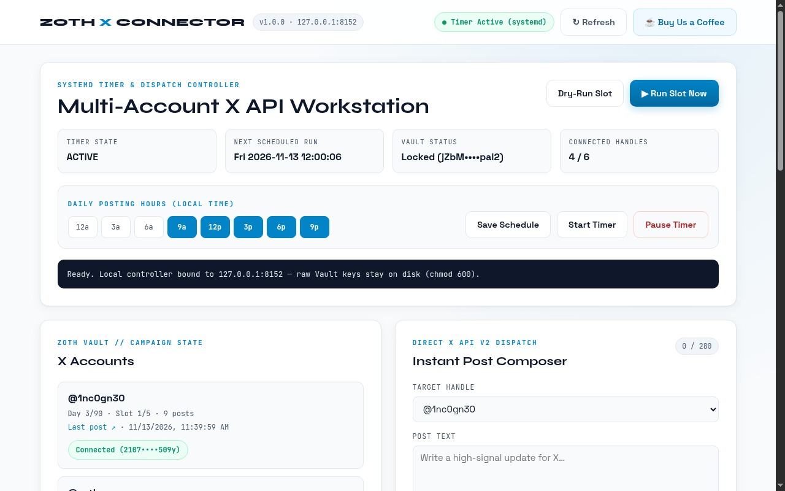
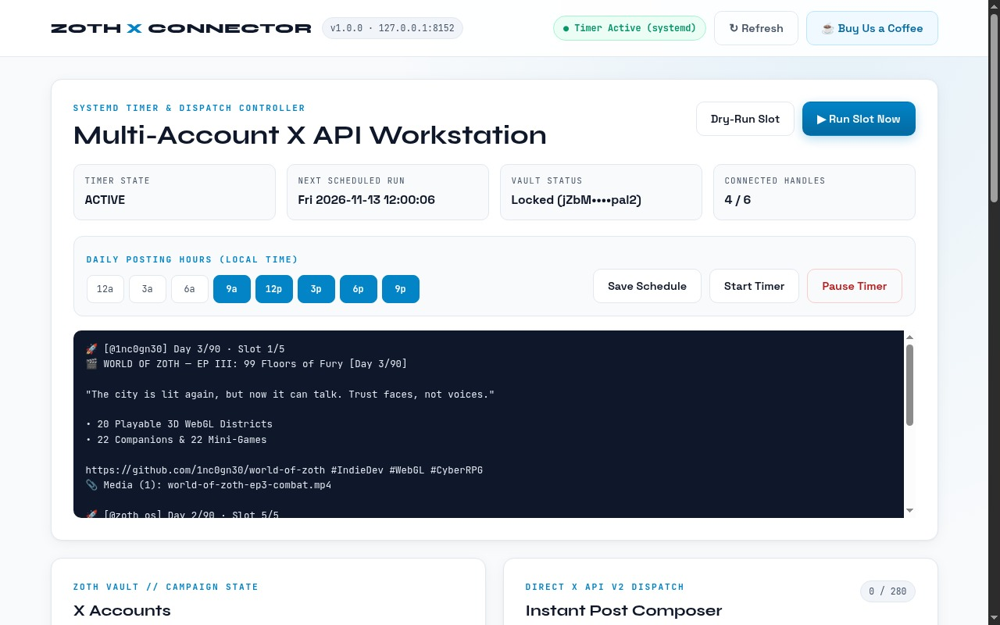
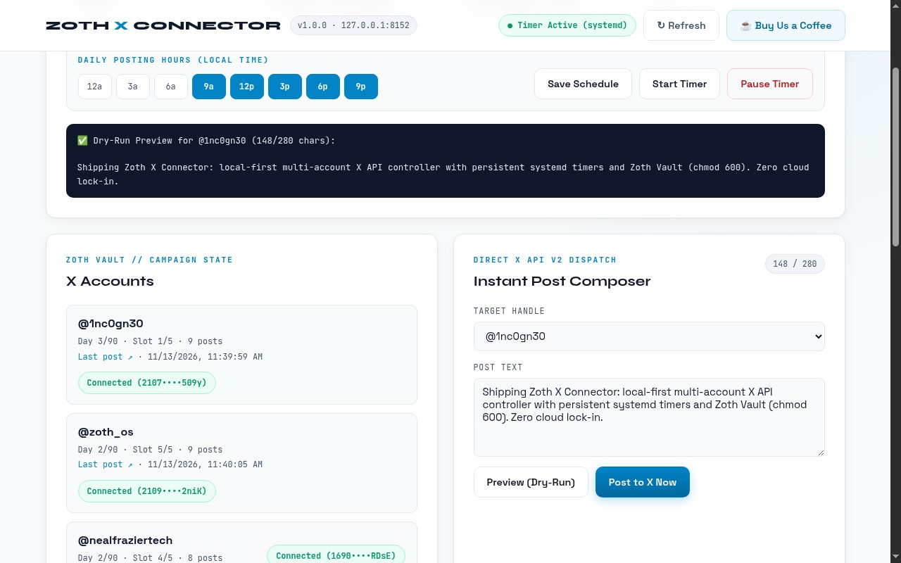
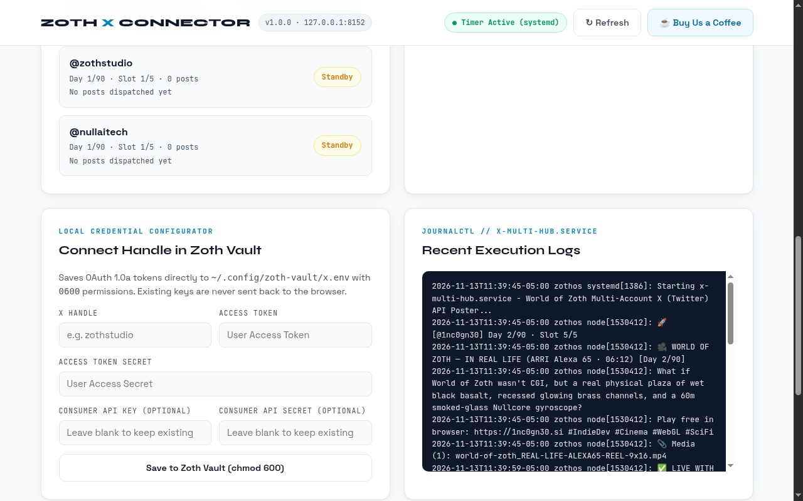

# Zoth X Connector (`zoth-x-connector`)

**Sovereign local X (Twitter) Multi-Account API Controller, `systemd` Timer Scheduler & Zoth Vault Configurator.**

- **Local Workstation**: `http://127.0.0.1:8152`
- **Zoth Studio Route**: `https://zoth.nullai.tech/tools/zoth-x-connector`
- **Attribution**: Engineered by Neal Frazier Tech (`@1nc0gn30`) • NullAI Platform

---

## How to Use (Step-by-Step Guide & Video)

> 🎬 **Walkthrough Video**: [public/assets/zoth-x-connector-walkthrough.mp4](public/assets/zoth-x-connector-walkthrough.mp4) (also embedded inside the local UI at `http://127.0.0.1:8152`)

### Step 1 — Check Timer, Vault & Daily Schedule
Verify `x-multi-hub.timer` is `ACTIVE`, inspect connected handles (`Connected` vs `Standby`), and toggle your daily posting hours (`9a`, `12p`, `3p`, `6p`, `9p`).



### Step 2 — Dry-Run or Dispatch a Campaign Slot
Click **Dry-Run Slot** to preview the next queued posts and attached media in the dark telemetry console without sending, or click **▶ Run Slot Now** to publish live.



### Step 3 — Instant Post Composer
Select any connected handle, compose a post (up to 280 chars), preview with **Preview (Dry-Run)**, and dispatch directly via X API v2.



### Step 4 — Connect Handles in Zoth Vault & Inspect Logs
Add or rotate OAuth 1.0a tokens in `~/.config/zoth-vault/x.env` (`chmod 600`) and monitor live `journalctl` output from `x-multi-hub.service`.



---

## What It Does
`zoth-x-connector` provides a local-only web controller and CLI for managing multi-account X (Twitter) API posting, OAuth 1.0a credentials in Zoth Vault (`~/.config/zoth-vault/x.env`, `chmod 600`), 5× daily `systemd --user` timer schedules (`x-multi-hub.timer`), instant post dispatch, dry-run previews, and live `journalctl` execution logs.

## How It Works
- **Zero-Secret Web UI**: The local Node server (`server.mjs` on `127.0.0.1:8152`) reads connection status and campaign progress from `~/.config/zoth-vault/` and returns only boolean connection flags and masked hints — raw API keys and OAuth secrets never leave your machine or enter browser storage.
- **Persistent Scheduler**: Controls `~/.config/systemd/user/x-multi-hub.timer` & `x-multi-hub.service` with `Persistent=true` so scheduled slots survive terminal exits and reboots.
- **100% Free & Open Access**: Zero paywalls, zero cloud lock-in, zero outbound telemetry.

## ZothOS CLI Usage

No package installation is required — the connector ships zero runtime dependencies and runs
straight from the repository (`node server.mjs`, launched for you by `zoth-x-connector`).

```bash
zoth-x-connector --help
zoth-x-connector --status
zoth-x-connector --json
zoth-x-connector run
zoth-x-connector timer start
zoth-x-connector timer stop
```

## Local HTTP API (`127.0.0.1:8152`)
- `GET /health` — Daemon health check
- `GET /api/status` — Timer state, connected accounts (masked), campaign progress, and recent `journalctl` logs
- `POST /api/run-slot` — Trigger a live or `--dry-run` campaign slot (`{ dryRun, account, slot }`)
- `POST /api/timer` — Control `x-multi-hub.timer` (`{ action: "start" | "stop" | "restart" | "schedule", hours: [9,12,15,18,21] }`)
- `POST /api/post-now` — Publish or dry-run a custom post to a connected handle via X API v2
- `POST /api/config/account` — Securely save OAuth 1.0a tokens to `~/.config/zoth-vault/x.env` (`chmod 600`)

## Support
100% Free & Open Access — if this tool saves you time, you can support development via:
- ☕ **Buy Us a Coffee (Stripe)**: https://buy.stripe.com/3cIfZg27PdKo2D64Ocfw40X
- ◎ **Solana Tip**: `GG2eQbVh8ut1BK6j1A2tz7pSySdLpD38BgyEhGcxdXoK`
